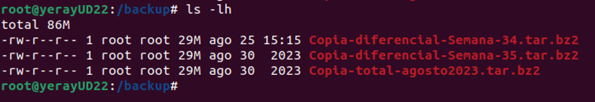

# 🧪 Supuesto Práctico UT03 *Automatización de tareas de mantenimiento* { .card }

!!! info "OBJETIVOS"
    - Consultar y filtrar registros de eventos en Windows Server.
    - Crear scripts en PowerShell que trabajen con los registros de eventos.
    - Automatizar la gestión de software y el mantenimiento en Ubuntu mediante scripts.
    - Programar tareas en Windows de forma gráfica y con PowerShell.
    - Planificar tareas y copias de seguridad en Ubuntu con `cron`, `anacron`, temporizadores de `systemd` y `rsync`.
    - Monitorizar el rendimiento del sistema con `sysstat`.

!!! info "RECURSOS"
    - Una máquina virtual Ubuntu 26 con acceso a terminal y privilegios de superusuario.
    - Una máquina virtual con Windows Server, con PowerShell y el Programador de tareas disponibles.
    - Un editor de texto y acceso a un repositorio (GitHub o similar) para entregar los scripts.

!!! warning "ADVERTENCIA"
    - Sustituye `nombre` por tu nombre en los ficheros (ej.: `yeraysp31-2.ps1`).
    - Ejecuta los scripts de Windows en PowerShell **como administrador**.
    - En tu repositorio de scripts, crea una carpeta **`UT03`** y guarda en ella todos los scripts de este supuesto.
    - Las dudas sobre los scripts se resolverán los días que se trabaje scripting en clase.

## **Windows Server** { .seccion }

### 1. Vista personalizada de advertencias en el Visor de eventos
En el Visor de eventos de Windows Server, crea una vista personalizada con el nombre **`nombrewarning`** (sustituyendo `nombre` por tu nombre). La vista debe mostrar únicamente los eventos de nivel **advertencia** y **error** que se hayan registrado en el sistema durante el **último mes**, de forma que el administrador pueda revisar de un vistazo qué problemas ha tenido el servidor recientemente. Comprueba que el filtro funciona correctamente y que la vista queda guardada dentro del Visor de eventos para poder consultarla en cualquier momento. La vista debe mostrar **como mínimo un evento**: si en tu sistema no hay advertencias ni errores en ese periodo, investiga cómo forzar uno, provócalo y vuelve a mostrar la vista para demostrar que aparece.

### 2. Script de inicios de sesión entre dos fechas
Crea un script **`nombresp31-2.ps1`** al que se le pasen por parámetros dos fechas: una **fecha de inicio** y una **fecha de fin**. El script debe consultar los registros del sistema y mostrar un listado con todos los inicios de sesión que se hayan producido entre esas dos fechas, indicando para cada uno el **día**, la **hora** y el **usuario** que inició sesión. Del listado se deben excluir los inicios de sesión del usuario **SYSTEM**, ya que no corresponden a personas. Busca en los apuntes en qué registro se guarda esta información y cómo se identifica un inicio de sesión. Ejecútalo con un rango de fechas que devuelva **como mínimo 7 registros**; la salida debe ser similar a la siguiente:

### 3. Script con menú de registros de eventos
Crea un script **`nombresp31-3.ps1`** que muestre un **menú** con los diferentes tipos de registros de eventos que existen en el sistema, cada uno con un **número asignado**. Ten en cuenta que no todos los sistemas tienen los mismos tipos de registro, por lo que el menú debe construirse a partir de los registros que tenga la máquina donde se ejecuta y no escribirse a mano. Al elegir una opción, el script mostrará **cuántos eventos hay** de ese tipo y un listado con los **12 últimos registros**, y después volverá a mostrar el menú. Para salir hay que pulsar **0**, y cualquier opción que no exista debe indicarse como no válida.

## **Ubuntu** { .seccion }

### 4. Script de desinstalación de programas desde un listado
Crea un script **`nombresp31-4.sh`** que desinstale automáticamente los programas indicados en un fichero de texto plano llamado **`programas.txt`**, que se encontrará en el **mismo directorio que el script**. En cada línea del fichero estará escrito el nombre de un programa diferente y reconocido por el sistema. El script debe recorrer el fichero, eliminar cada programa y mostrar por pantalla qué está haciendo en cada momento. Si alguno de los programas de la lista no está instalado, debe avisarlo y continuar con el siguiente sin detenerse. Para probarlo, prepara un fichero con varios programas instalados previamente y demuestra que, tras la ejecución, ya no están en el sistema.

### 5. Creación de un script de mantenimiento en GNU/Linux
Crea un script **`nombresp31-5.sh`** que revise todos los archivos de registro del sistema que se encuentran en `/var/log` y localice las líneas que contengan las palabras **"error"** o **"fail"**. Con esas líneas, el script generará un **informe nuevo** en el que quede claro de qué archivo original procede cada bloque de líneas encontradas, de forma que un administrador pueda revisar rápidamente los problemas del sistema. El informe debe ser fácil de leer, separando visualmente cada archivo de origen. Pruébalo manualmente y, si no hay errores en los registros, provoca alguno para demostrar que el script los detecta correctamente.

## **Windows Server** { .seccion }

### 6. Programación de tareas en Windows Server
Programa en Windows Server **dos tareas** de libre elección: la primera la crearás desde la **interfaz gráfica** del Programador de tareas y la segunda **totalmente con PowerShell**, sin usar la interfaz gráfica en ningún momento. Elige tareas diferentes entre sí y que tengan sentido en un servidor, y **justifica** por qué las has elegido, qué desencadenador has usado en cada una y qué beneficio aportan al sistema. Una vez creadas, demuestra que ambas están en estado **listo** (*Ready*), preparadas para ejecutarse cuando llegue su momento: la tarea creada de forma gráfica lo mostrarás desde la interfaz del Programador de tareas, y la tarea creada con PowerShell lo mostrarás mediante comandos.

## **Ubuntu** { .seccion }

### 7. Monitorización del espacio en disco con cron
Crea un script **`nombresp31-7.sh`** que compruebe el porcentaje de ocupación de cada partición del sistema y, cuando alguna supere el **80 %**, añada una línea a un fichero de registro propio indicando la fecha, la hora, la partición y el porcentaje de uso. Programa el script con `cron` para que se ejecute **cada 15 minutos, de lunes a viernes, entre las 8:00 y las 15:00**, y explica qué significa cada campo de la entrada que has creado. Para demostrar que funciona, baja temporalmente el umbral o llena una partición de prueba, y muestra cómo van apareciendo nuevas líneas en el registro a medida que se ejecuta la tarea programada.

**Nota:** prueba siempre el script de forma manual antes de programarlo. Un error en una tarea automática es mucho más difícil de detectar cuando se ejecuta sola, sin supervisión directa.

### 8. Copias de seguridad con cron y anacron
Crea en el directorio raíz dos carpetas: **`bacnombre`**, destino de las copias de seguridad, y **`scrnombre`**, destino de los scripts. Las copias se harán siempre de la carpeta de los usuarios del sistema, es decir, del directorio `/home`. Con `cron`, programa una tarea que **cada semana** realice una copia de seguridad **diferencial** con el nombre **`CopDifSem-<n.º de semana del año>`**. Con `anacron`, programa dos tareas **mensuales**: una que haga una **limpieza** eliminando solo las copias diferenciales del directorio de copias, y otra que realice una copia de seguridad **total** con el nombre **`CopTot-<nombre del mes completo y año completo>`**. Para comprobar la configuración, **fuerza un cambio de fecha** desde la línea de comandos que provoque la ejecución de los scripts anteriores y explica cómo lo has hecho. Por último, muestra el directorio de copias en formato largo con **al menos 3 copias de seguridad** en su interior y el fichero de **marcas de tiempo** que demuestra que las tareas de `anacron` se han ejecutado. El directorio de copias debe quedar con un aspecto similar a este:

**Nota:** prueba cada script de copia a mano y, si es posible, sobre una carpeta de prueba antes de dejarlo programado.

### 9. Sincronización de copias con rsync y un temporizador de systemd
Crea un script **`nombresp31-9.sh`** que use **`rsync`** para mantener en `/bacnombre/espejo` una copia exacta y sincronizada de tu directorio personal, conservando los permisos y las fechas de los ficheros. Crea un **temporizador de `systemd`** (*timer*) con su servicio asociado que lo ejecute **todos los días a las 22:00**, y demuestra que el temporizador está activo y cuándo será su próxima ejecución. Después, lanza el servicio manualmente, crea, modifica y borra algunos ficheros en tu directorio personal y vuelve a lanzarlo: demuestra que en la segunda ejecución solo se transfieren los cambios, que los ficheros borrados también desaparecen de la copia espejo y que las ejecuciones quedan registradas en el sistema.

### 10. Prueba de estrés y monitorización con sysstat
Instala y activa **`sysstat`** para que recoja estadísticas del sistema, e instala también una aplicación de **prueba de estrés** de tu elección. Lanza una prueba de al menos **5 minutos** que cargue la CPU y la memoria mientras `sysstat` registra los datos, anotando la hora de inicio y de fin. A continuación, extrae de los datos recogidos los valores de uso de CPU y de memoria del periodo de la prueba y genera con ellos un fichero **`nombresp31-10.json`**. Comprueba que el JSON es válido y explica brevemente qué muestran los datos: cómo se comporta el sistema antes, durante y después de la prueba.

!!! example "ENTREGA"
    - En caso de no indicar lo contrario cada apartado tendrá el mismo valor.
    - Para una calificación correcta se han de seguir las instrucciones del documento “**Pautas del curso**”, que se encuentra en el apartado de recursos del Campus.
    - La entrega debe incluir:
        1. Vista personalizada `nombrewarning` y scripts `nombresp31-2.ps1` y `nombresp31-3.ps1`, comentados, con sus capturas (apartados 1, 2 y 3).
        2. Scripts `nombresp31-4.sh` y `nombresp31-5.sh`, comentados, el fichero `programas.txt` y capturas de su ejecución (apartados 4 y 5).
        3. Justificación de las dos tareas de Windows, código PowerShell comentado y capturas de su estado listo (apartado 6).
        4. Script `nombresp31-7.sh`, entrada de `cron` y capturas de su comprobación (apartado 7).
        5. Scripts de copia, entradas de `cron` y `anacron` y capturas del cambio de fecha, del directorio de copias y de las marcas de tiempo (apartado 8).
        6. Script `nombresp31-9.sh`, ficheros del servicio y del temporizador de `systemd` y capturas de sus ejecuciones (apartado 9).
        7. Fichero `nombresp31-10.json` y capturas de la prueba de estrés (apartado 10).
        8. Enlace al repositorio de scripts con el historial de commits.
    - <strong class="aviso-rojo">Si no se incluye el enlace al repositorio de scripts, el supuesto no se evaluará.</strong>
    - <strong class="aviso-rojo">El último commit del repositorio debe tener fecha anterior a la fecha de entrega del supuesto.</strong>
    - Entregar un documento **“pdf”** a través del Campus. El nombre del archivo debe ser: “**Apellido1Apellido2Nombre_SPXX**”.
