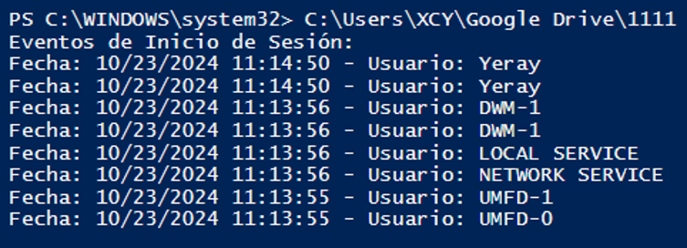

# 🧪 Supuesto Práctico UT03 *Automatización de tareas de mantenimiento* { .card }

!!! info "OBJETIVOS"
    - Consultar y filtrar registros de eventos en Windows Server.
    - Crear scripts en PowerShell que trabajen con los registros de eventos.
    - Automatizar la gestión de software y el mantenimiento en Ubuntu mediante scripts.

!!! info "RECURSOS"
    - Una máquina virtual Ubuntu 26 con acceso a terminal y privilegios de superusuario.
    - Una máquina virtual con Windows Server y PowerShell.
    - Un editor de texto y acceso a un repositorio (GitHub o similar) para entregar los scripts.

!!! warning "ADVERTENCIA"
    - Sustituye `nombre` por tu nombre en los ficheros (ej.: `yeraysp31-3ses`).
    - Ejecuta los scripts de Windows en PowerShell **como administrador**.
    - En tu repositorio de scripts, crea una carpeta **`UT03`** y guarda en ella todos los scripts de este supuesto.
    - Las dudas sobre los scripts se resolverán los días que se trabaje scripting en clase.

## **Windows Server** { .seccion }

### 1. Vista personalizada de advertencias en el Visor de eventos
En el Visor de eventos de Windows Server, crea una vista personalizada con el nombre **`nombrewarning`** (sustituyendo `nombre` por tu nombre). La vista debe mostrar únicamente los eventos de nivel **advertencia** y **error** que se hayan registrado en el sistema durante el **último mes**, de forma que el administrador pueda revisar de un vistazo qué problemas ha tenido el servidor recientemente. Comprueba que el filtro funciona correctamente y que la vista queda guardada dentro del Visor de eventos para poder consultarla en cualquier momento. La vista debe mostrar **como mínimo un evento**: si en tu sistema no hay advertencias ni errores en ese periodo, investiga cómo forzar uno, provócalo y vuelve a mostrar la vista para demostrar que aparece.

### 2. Script de inicios de sesión entre dos fechas
Crea un script **`nombresp31-2.ps1`** al que se le pasen por parámetros dos fechas: una **fecha de inicio** y una **fecha de fin**. El script debe consultar los registros del sistema y mostrar un listado con todos los inicios de sesión que se hayan producido entre esas dos fechas, indicando para cada uno el **día**, la **hora** y el **usuario** que inició sesión. Del listado se deben excluir los inicios de sesión del usuario **SYSTEM**, ya que no corresponden a personas. Busca en los apuntes en qué registro se guarda esta información y cómo se identifica un inicio de sesión. Ejecútalo con un rango de fechas que devuelva **como mínimo 7 registros**; la salida debe ser similar a la siguiente:

### 3. Script con menú de registros de eventos
Crea un script **`nombresp31-3.ps1`** que muestre un **menú** con los diferentes tipos de registros de eventos que existen en el sistema, cada uno con un **número asignado**. Ten en cuenta que no todos los sistemas tienen los mismos tipos de registro, por lo que el menú debe construirse a partir de los registros que tenga la máquina donde se ejecuta y no escribirse a mano. Al elegir una opción, el script mostrará **cuántos eventos hay** de ese tipo y un listado con los **12 últimos registros**, y después volverá a mostrar el menú. Para salir hay que pulsar **0**, y cualquier opción que no exista debe indicarse como no válida.

## **Ubuntu** { .seccion }

### 4. Script de desinstalación de programas desde un listado
Crea un script **`nombresp31-4.sh`** que desinstale automáticamente los programas indicados en un fichero de texto plano llamado **`programas.txt`**, que se encontrará en el **mismo directorio que el script**. En cada línea del fichero estará escrito el nombre de un programa diferente y reconocido por el sistema. El script debe recorrer el fichero, eliminar cada programa y mostrar por pantalla qué está haciendo en cada momento. Si alguno de los programas de la lista no está instalado, debe avisarlo y continuar con el siguiente sin detenerse. Para probarlo, prepara un fichero con varios programas instalados previamente y demuestra que, tras la ejecución, ya no están en el sistema.

### 5. Creación de un script de mantenimiento en GNU/Linux
Crea un script **`nombresp31-5.sh`** que revise todos los archivos de registro del sistema que se encuentran en `/var/log` y localice las líneas que contengan las palabras **"error"** o **"fail"**. Con esas líneas, el script generará un **informe nuevo** en el que quede claro de qué archivo original procede cada bloque de líneas encontradas, de forma que un administrador pueda revisar rápidamente los problemas del sistema. El informe debe ser fácil de leer, separando visualmente cada archivo de origen. Pruébalo manualmente y, si no hay errores en los registros, provoca alguno para demostrar que el script los detecta correctamente.

## continuara-.....

<!--
APARTADOS OCULTOS (6-14) Y CONTENIDO ASOCIADO: no se muestran en la web.

Objetivos ocultos:
    - Programar tareas de mantenimiento con `cron`, `anacron` y `at`.
    - Usar el Programador de tareas de Windows (gráfico y PowerShell).
    - Automatizar la creación de cuentas de usuario de forma segura.
    - Documentar todas las tareas automatizadas.

Recursos ocultos:
    - Una máquina virtual con Windows Server, con PowerShell y el Programador de tareas disponibles.
    - Un listado de al menos 5 usuarios ficticios en formato CSV (`usuario;nombre;grupo`) para la automatización de cuentas.

Entregables ocultos:
        - Scripts de automatización de cuentas (Linux y Windows), comentados.
        - Capturas de cada tarea programada (gráfica y por comandos).
        - Ficheros de marca de tiempo de `anacron` y directorio de copias de seguridad (apartado 9).
        - Ficha de documentación de todas las tareas (apartado 14), incluyendo el XML exportado de Windows.

## **Diagnóstico y mantenimiento en GNU/Linux** { .seccion }

!!! info ""
    - Carpeta de destino de las copias de seguridad: `/bacnombre`
    - Carpeta de destino de los scripts: `/scrnombre`
    - Prueba cada script manualmente antes de programarlo.

### 6. Diagnóstico previo del sistema
Antes de automatizar nada, recopila la información básica de ambos sistemas (versión del sistema operativo y recursos disponibles) y documenta su estado inicial, para poder comparar más adelante si alguna tarea automatizada lo ha modificado de forma inesperada.

### 7. Planificación periódica con cron
Programa con `cron` una tarea **semanal** que haga una copia de seguridad diferencial de `/home` con el nombre `CopDifSem-<nº de semana>` y explica qué significa cada campo de la entrada que has creado.

### 8. Planificación con anacron y con at
Programa con `anacron` dos tareas **mensuales**: una que limpie las copias diferenciales antiguas de `bacnombre` y otra que haga una copia **total** con el nombre `CopTot-<mes y año completos>`. Programa también con `at` una ejecución puntual de una tarea de mantenimiento para el día siguiente y explica la diferencia entre `cron`, `anacron` y `at`.

### 9. Comprobación forzada de las tareas planificadas en Linux
Fuerza la ejecución de las tareas de los apartados 7 y 8 cambiando la fecha del sistema y demuestra que se han ejecutado: en `bacnombre` debe haber **al menos 3 copias de seguridad** y `anacron` debe haber registrado sus ejecuciones.

## **Programador de tareas de Windows** { .seccion }

### 10. Planificación gráfica con el Programador de tareas de Windows
Crea en Windows Server, desde la interfaz gráfica del Programador de tareas, dos tareas: una que limpie el escritorio al iniciar sesión y otra de elección libre. Justifica en ambos casos el desencadenador elegido y el beneficio que aporta al sistema.

### 11. Planificación por PowerShell en Windows
Crea mediante PowerShell dos tareas programadas distintas de las del apartado anterior: una que inicie PowerShell ISE **un minuto después de iniciar sesión** y otra de elección libre. Comprueba que ambas quedan registradas en el sistema.

## **Cuentas de usuario y documentación** { .seccion }

### 12. Automatización de la creación de cuentas de usuario
A partir del listado CSV de los recursos, crea un script (en Linux o en Windows) que dé de alta automáticamente todas las cuentas del listado, asigne cada una a su grupo y compruebe que se han creado correctamente.

### 13. Restricciones de seguridad aplicadas
Aplica a las cuentas del apartado 12 al menos tres restricciones de seguridad: contraseña temporal distinta por usuario, cambio obligatorio en el primer inicio de sesión y fecha de caducidad. Justifica por qué cada una reduce el riesgo de la automatización.

### 14. Documentación final de las tareas automáticas
Elabora una ficha (tabla) de cada tarea programada en la práctica (mínimo 6 entre Linux y Windows) con su nombre, sistema, mecanismo, desencadenador, acción, usuario de ejecución y dónde se comprueba su ejecución. En Windows, exporta además en XML al menos una de las tareas.

!!! tip "ANTES DE PROGRAMAR EN PRODUCCIÓN, SIMULA"
    Prueba siempre primero cada script de forma manual y, si es posible, sobre un directorio o listado de prueba antes de programarlo con `cron`, `anacron` o el Programador de tareas. Un error en un script de limpieza o de alta masiva de usuarios se vuelve mucho más difícil de detectar cuando se ejecuta solo automáticamente, de madrugada y sin supervisión directa.

-->

!!! example "ENTREGA"
    - En caso de no indicar lo contrario cada apartado tendrá el mismo valor.
    - Para una calificación correcta se han de seguir las instrucciones del documento “**Pautas del curso**”, que se encuentra en el apartado de recursos del Campus.
    - La entrega debe incluir:
        1. Vista personalizada `nombrewarning` y scripts `nombresp31-3ses` y `nombresp31-3eve`, comentados, con sus capturas (apartados 1, 2 y 3).
        2. Scripts `nombresp31-7pro` y `mantenimiento.sh`, comentados, el fichero `programas.txt` y capturas de su ejecución (apartados 4 y 5).
        3. Enlace al repositorio de scripts con el historial de commits.
    - <strong style="color:red">Si no se incluye el enlace al repositorio de scripts, el supuesto no se evaluará.</strong>
    - <strong style="color:red">El último commit del repositorio debe tener fecha anterior a la fecha de entrega del supuesto.</strong>
    - Entregar un documento **“pdf”** a través del Campus. El nombre del archivo debe ser: “**Apellido1Apellido2Nombre_SPXX**”.
