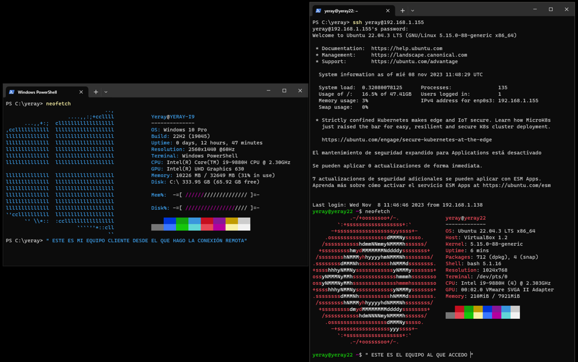

# 🧪 Supuesto Práctico UT04 *Escritorio remoto, acceso remoto y VPN* { .card }

!!! info "OBJETIVOS"
    - Publicar aplicaciones con RemoteApp de Remote Desktop Services.
    - Desplegar instancias Windows y Ubuntu en AWS.
    - Configurar y asegurar un servidor SSH en Windows.
    - Ejecutar aplicaciones gráficas remotas con reenvío X11.
    - Crear túneles SSH hacia servicios no cifrados.
    - Usar RustDesk y Guacamole para el acceso remoto.
    - Montar una VPN WireGuard y gestionarla con WireGuard-UI.
    - Capturar y desplegar imágenes de sistemas por red con FOG.

!!! info "RECURSOS"
    - Windows Server 2025 y cliente Windows 11 locales.
    - Cuenta de AWS (Windows Server 2022 y Ubuntu Server 26.04 LTS).
    - Cliente Ubuntu Desktop 26.04.
    - Dispositivo móvil Android/iOS (real o emulado).
    - Servidor Proxmox para el contenedor LXC.
    - PuTTY, Xming, RustDesk, Guacamole y WireGuard.
    - Visual Studio Code y MySQL Server.
    - Ubuntu Server de 100 GB con FOG y cliente Linux Mint.

## **Remote Desktop Services** { .seccion }

### 1. Visual Studio Code como RemoteApp con Remote Desktop Services
En un **Windows Server 2025** local, instala y configura el rol **Remote Desktop Services** para que los usuarios puedan utilizar **Visual Studio Code** como aplicación **RemoteApp** a través del navegador web. Realiza una implementación de escritorio basada en sesiones que incluya, como mínimo, los servicios de Agente de conexión a Escritorio remoto, Acceso web a Escritorio remoto y Host de sesión de Escritorio remoto, y comprueba que todos quedan en funcionamiento. A continuación, instala Visual Studio Code en el servidor para todos los usuarios, crea una colección de sesiones y publica la aplicación como RemoteApp, asignando el acceso a un grupo de usuarios concreto. Instala también en el servidor el rol de servidor web (IIS) con un sitio preparado para alojar los ficheros de la práctica. Desde un equipo cliente **Windows 11** local, accede con el navegador al portal de Acceso web a Escritorio remoto, inicia sesión con un usuario autorizado y abre Visual Studio Code. Desde esa aplicación remota, crea una pequeña web con un mensaje de «Hola mundo» y guárdala en la carpeta del sitio web del servidor, de modo que todo el trabajo se haga desde el cliente, sin iniciar sesión directamente en el servidor. Por último, abre la web publicada desde el navegador del cliente. Documenta con capturas todos los pasos: la instalación del rol, la colección, la publicación de la RemoteApp, el acceso al portal, Visual Studio Code en funcionamiento y la web «Hola mundo» mostrada en el navegador del cliente.

## **Acceso y administración remota** { .seccion }

### 2. Servidor SSH en una instancia Windows Server de AWS
Crea una instancia de **Windows Server 2022** en AWS y realiza una conexión remota por SSH desde un cliente **Windows 11** local. En primer lugar, comprueba que la característica OpenSSH está instalada en ambos equipos y configura el servidor SSH para que arranque al iniciar Windows, de forma que el acceso remoto siga disponible tras cualquier reinicio de la instancia; demuestra con PowerShell que tanto el cliente como el servidor SSH están activos. A continuación, configura el firewall de Windows para permitir el acceso al servidor SSH creando o ajustando la regla de entrada correspondiente; recuerda que configurar no es desactivar, por lo que el firewall debe permanecer activo en todos sus perfiles. Revisa también el grupo de seguridad de la instancia en AWS, ya que sin la regla de entrada adecuada la conexión nunca llegará al servidor. Después, modifica la configuración estándar de SSH en Windows editando el fichero `sshd_config` para cambiar el puerto del **22** al **2222**, reinicia el servicio y actualiza tanto el firewall como el grupo de seguridad. Comprueba que las conexiones funcionan correctamente con el nuevo puerto. Una vez dentro, ejecuta `fastfetch` y presenta la comprobación como una doble pantalla en el cliente: a la izquierda, la terminal del cliente con su `fastfetch`, y a la derecha, la sesión SSH con el `fastfetch` del servidor.

Ejemplo de comprobación (conexión de Windows a Ubuntu): a la izquierda, el equipo cliente; a la derecha, el equipo al que se accede.

### 3. Firefox remoto con Xming y reenvío X11
Crea una instancia de **Ubuntu Server 26.04 LTS** en AWS e instala en ella el navegador **Firefox**. Desde un cliente **Windows 11** local, conéctate a la instancia utilizando **Xming** como servidor gráfico y el reenvío X11 mediante SSH. Prepara primero la instancia: Ubuntu Server no incluye entorno gráfico, de modo que, además de Firefox, deberás instalar los paquetes mínimos necesarios para el reenvío (por ejemplo, `xauth`) y comprobar en `sshd_config` que la opción `X11Forwarding` está habilitada. En el cliente, instala y arranca Xming y configura tu cliente SSH (PuTTY o el cliente OpenSSH de Windows) para que active el reenvío X11 y dirija la salida gráfica hacia el servidor X local. Una vez establecida la conexión, comprueba que la variable `DISPLAY` está definida en la sesión remota y ejecuta una aplicación gráfica en la instancia, por ejemplo `firefox`, para comprobar que la interfaz se muestra correctamente en tu sistema Windows aunque el programa se esté ejecutando realmente en AWS. Incluye una captura de la aplicación en funcionamiento en la que se aprecie que la ventana pertenece a la instancia remota y explica brevemente el proceso realizado, indicando qué papel cumple cada componente (Xming, SSH y la aplicación remota) y por qué el tráfico gráfico viaja cifrado dentro de la conexión SSH.

### 4. Túnel SSH con PuTTY hacia MySQL
Desde un cliente **Windows 11** local, crea un túnel SSH con **PuTTY** hacia la instancia de **Ubuntu Server** de AWS que redirija el puerto **3306** (origen, en el cliente) hacia el puerto **5252** (destino) del servidor remoto, donde se está ejecutando MySQL. En la instancia, instala MySQL Server, cambia su puerto de escucha al 5252 y crea una base de datos de prueba con una tabla de usuarios y un usuario con permisos sobre ella. Ten en cuenta que el puerto 5252 no debe abrirse en el grupo de seguridad de AWS: la única vía de acceso a la base de datos será el propio túnel, que viaja cifrado por SSH. En PuTTY, configura la sesión hacia la instancia con su clave y añade en la sección *Connection › SSH › Tunnels* la redirección local correspondiente. Con el túnel establecido, conéctate desde el cliente a `127.0.0.1:3306` con un cliente MySQL (por ejemplo, MySQL Workbench o la línea de comandos) y comprueba el correcto funcionamiento del túnel accediendo a la base de datos y realizando una operación sencilla, como un `INSERT` en la tabla de usuarios, seguida de una consulta que muestre el registro insertado. Documenta los pasos realizados, la configuración del túnel en PuTTY, el comando SQL ejecutado y una captura del resultado obtenido, verificando también desde la propia instancia que el dato ha llegado correctamente a la base de datos.

### 5. Escritorio remoto con RustDesk
Realiza una conexión remota desde un cliente **Ubuntu Desktop 26.04** a la instancia de **Ubuntu Server** de AWS con **RustDesk**, una herramienta moderna y de código abierto de acceso remoto y escritorio compartido. Como Ubuntu Server no incluye entorno gráfico, prepara primero en la instancia un escritorio ligero que RustDesk pueda compartir y comprueba que sus recursos son suficientes para usarlo con fluidez. Instala RustDesk en ambos equipos, revisa su configuración (identificador, contraseña de acceso permanente y permisos de control) y establece la conexión desde el cliente, verificando que puedes manejar el escritorio remoto con normalidad. Como comprobación, ejecuta `fastfetch` en ambos equipos y presenta una captura tomada desde el cliente con su terminal a la izquierda y, a la derecha, la ventana de RustDesk con el `fastfetch` del servidor. Redacta después una breve explicación del proceso de instalación, configuración y uso de la herramienta, destacando sus ventajas frente a otras soluciones como AnyDesk o TeamViewer: licencia y coste, código abierto, posibilidad de desplegar un servidor de retransmisión propio, privacidad de los datos y rendimiento. Indica también qué puertos o servicios intervienen en la conexión y si ha sido necesario modificar el grupo de seguridad de AWS para que funcione, así como las medidas de seguridad que ofrece la propia herramienta.

### 6. Acceso desde el móvil con Guacamole
Realiza una conexión remota desde un dispositivo **móvil** (real o emulado) a una de las instancias de AWS utilizando **Apache Guacamole**, una pasarela de escritorio remoto sin cliente que permite acceder a equipos por SSH, RDP o VNC usando únicamente el navegador web. Despliega Guacamole en la instancia que elijas, configura un usuario de acceso propio, distinto del que viene por defecto, y define al menos una conexión hacia la instancia con el protocolo más adecuado según su sistema operativo. Abre en el grupo de seguridad de AWS solo los puertos imprescindibles, limitando el acceso en la medida de lo posible. Desde el navegador del móvil, inicia sesión en Guacamole, abre la conexión y ejecuta `fastfetch` en la terminal remota, capturando la pantalla del dispositivo móvil donde se muestre la información del sistema de la instancia. Comprueba también que la sesión es realmente usable desde la pantalla táctil: teclado virtual, desplazamiento y selección de texto. Para terminar, incluye una breve explicación del proceso realizado: cómo has instalado Guacamole, qué conexión has configurado, qué ventajas tiene un acceso basado solo en el navegador frente a instalar un cliente específico en el móvil y qué precauciones de seguridad has tenido en cuenta al publicar el servicio en Internet.

## **VPN** { .seccion }

### 7. WireGuard en un contenedor de Proxmox
Crea en **Proxmox** un contenedor LXC, instala **WireGuard** y configura lo necesario para permitir conexiones VPN desde dos clientes. Define la interfaz del servidor con su red privada, genera los pares de claves, habilita el reenvío de paquetes y comprueba que el servicio arranca automáticamente con el contenedor. El primer cliente será un dispositivo **móvil** Android o iOS con la aplicación oficial de WireGuard, al que importarás la configuración generada en el contenedor mediante código QR o archivo `.conf`; captura las pantallas donde se vea el túnel activo y las direcciones IP asignadas, verificando que la conexión a la red privada se ha realizado correctamente. El segundo será un **Ubuntu Desktop 26.04** en modo NAT, al que añadirás el archivo de configuración del cliente con sus claves y direcciones; verifica la conectividad con el contenedor e incluye la salida de `wg show` y pruebas de tráfico de red que confirmen que el túnel funciona, por ejemplo un `ping` a la dirección privada del servidor y la comprobación de que los contadores de datos aumentan.

Por último, desde el cliente Ubuntu Desktop accede al contenedor mediante SSH o consola e instala **WireGuard-UI**, una interfaz web para gestionar de forma visual las configuraciones de WireGuard sin editar a mano los ficheros del servidor. Protege el acceso a la interfaz con unas credenciales propias, distintas de las que vienen por defecto. Crea un nuevo usuario desde la interfaz web y genera una configuración de cliente desde la propia aplicación, aplicando los cambios y comprobando que es posible administrarla de manera sencilla. Documenta con capturas la instalación, el acceso a la interfaz, el alta del usuario y la configuración generada, y explica la utilidad de estas herramientas de gestión visual en entornos de red frente a la administración por comandos.

## **Despliegue remoto** { .seccion }

### 8. Captura y despliegue de imágenes con FOG
En un equipo con **Ubuntu Server** de **100 GB** de disco y la dirección IP **192.168.1xx.150** (donde *xx* es tu número de lista), instala y configura [FOG Project](https://fogproject.org/), la solución libre de clonación y despliegue de imágenes de sistemas a través de la red. Puedes apoyarte en el [Video](https://youtu.be/DaqxDAasKBs). Durante todo el apartado explica el procedimiento seguido y las decisiones tomadas, acompañando cada paso con capturas de las comprobaciones realizadas. Una vez instalado el servidor, captura una imagen del sistema de un equipo con **Linux Mint** y comprueba en la interfaz web de FOG que la imagen ha quedado almacenada correctamente.

A continuación, amplía el espacio de almacenamiento de imágenes en **100 GB** más, de forma que la interfaz web de FOG muestre un total de **200 GB**, y comprueba que los cambios se mantienen después de reiniciar el servidor. Después, ten en cuenta que, con la ampliación de puestos de trabajo en la empresa, la red ha pasado de ser una red privada de clase C a una red privada de clase B: la nueva red de trabajo es la **172.16.0.0/16**, por lo que deberás realizar los cambios correspondientes tanto en el servidor como en el propio aplicativo. Por último, trabajando ya con estas modificaciones, despliega en un equipo la imagen de Linux Mint almacenada en FOG e incluye una captura del despliegue en la pantalla de fondo azul donde se muestra la IP actual del servidor FOG.

## **Laboratorio** { .seccion }

### 9. Laboratorio en el aula
Laboratorio que se realizará en el aula. El enunciado se facilitará en clase.

### 10. Laboratorio en el aula
Laboratorio que se realizará en el aula. El enunciado se facilitará en clase.

!!! example "ENTREGA"
    - En caso de no indicar lo contrario cada apartado tendrá el mismo valor.
    - Para una calificación correcta se han de seguir las instrucciones del documento “**Pautas del curso**”, que se encuentra en el apartado de recursos del Campus.
    - La entrega debe incluir:
        1. Capturas de la implementación de Remote Desktop Services, de la RemoteApp de Visual Studio Code y de la web «Hola mundo» en el navegador del cliente (apartado 1).
        2. Capturas del servidor SSH de Windows, del firewall y de la doble pantalla con `fastfetch` por el puerto 2222 (apartado 2).
        3. Captura de Firefox remoto con Xming y del túnel SSH con el `INSERT` ejecutado (apartados 3 y 4).
        4. Explicación y capturas de RustDesk y Guacamole con `fastfetch` (apartados 5 y 6).
        5. Configuración de WireGuard (sin exponer claves privadas reales), capturas de los dos clientes, salida de `wg show` y capturas de WireGuard-UI (apartado 7).
        6. Explicación y capturas de FOG: imagen capturada, almacenamiento de 200 GB tras reiniciar, cambio a la red 172.16.0.0/16 y despliegue con la IP del servidor (apartado 8).
        7. Evidencias de los laboratorios realizados en el aula (apartados 9 y 10).
    - Entregar un documento **“pdf”** a través del Campus. El nombre del archivo debe ser: “**Apellido1Apellido2Nombre_SPXX**”.
